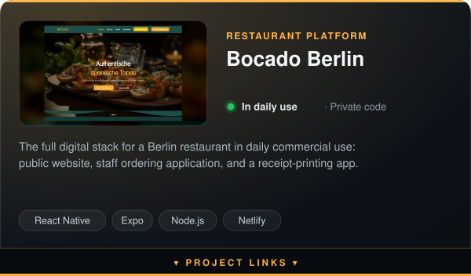
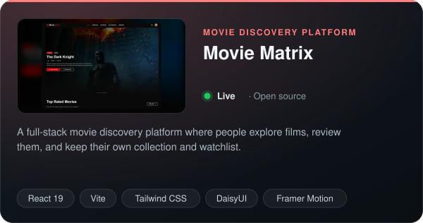
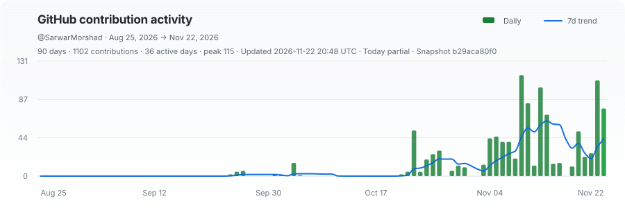

  

  

# 👨‍💻 console.log("Me")
  

*👋 Hi! I'm a full stack developer with a passion for building web applications that are not only functional but also  clean,  fast, and  user-friendly. I enjoy working across the entire stack — crafting sleek, responsive interfaces with HTML, CSS, React, TypeScript, while powering them with robust backend logic using Node.js, Express, and PostgreSQL. I believe in writing clean, maintainable code  and designing systems that scale . I'm constantly learning new technologies , improving my workflow , and embracing challenges that push my problem-solving skills. Whether it's building API, squashing bugs, or architecting new features, I bring creativity and curiosity to everything I do. Outside of coding, I enjoy geeking out about new tools, sharing knowledge, and collaborating with like-minded people on meaningful projects.*

---

## 🧰 Tech Stack

---

## 💼 Featured Projects
<table>
  <tr>
    <td width="50%" align="center">
      
      
      
    </td>
    <td width="50%" align="center">
      
      
      
    </td>
  </tr>
  <tr>
    <td width="50%" align="center">
      
      
      
    </td>
    <td width="50%" align="center">
      
      
      
    </td>
  </tr>
  <tr>
    <td width="50%" align="center">
      
      
      
    </td>
    <td width="50%" align="center">
      
      
      
    </td>
  </tr>
  <tr>
    <td width="50%" align="center">
      
      
    </td>
    <td width="50%" align="center">
      
      
    </td>
  </tr>
</table>

---

## 🤝 Let's Connect

 

 

> *Open to full-stack roles, freelance collabs & interesting conversations — let's build something great.*

 

---

# 📊 GitHub Stats

<!-- 
 -->

<!-- 

  

 -->

  

---

### ✍️ Random Dev Quote

---

### 🔝 Top Contributed Repo

---

