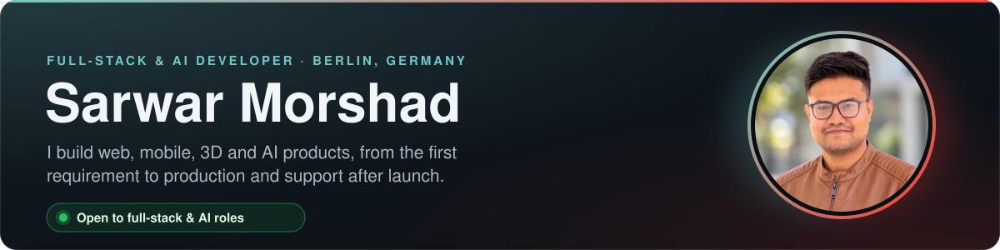
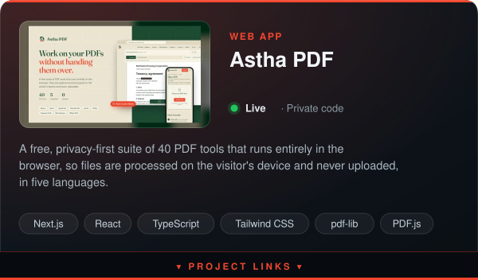
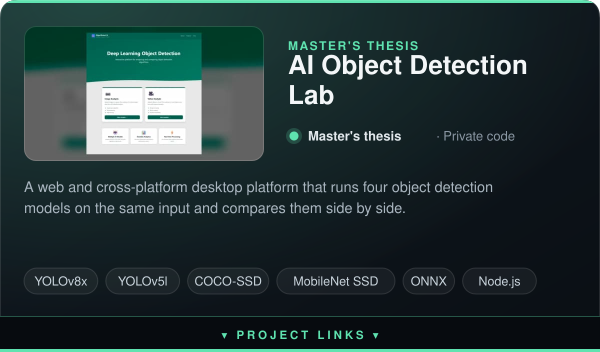
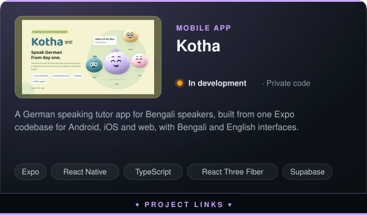
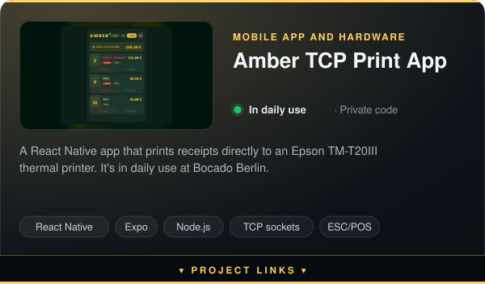
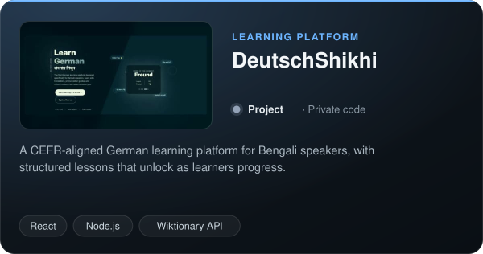
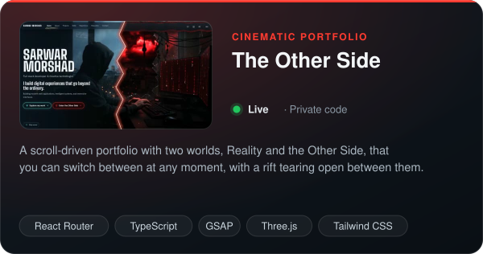
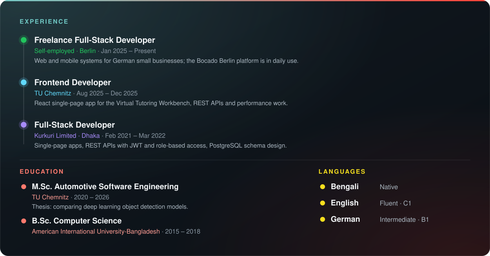
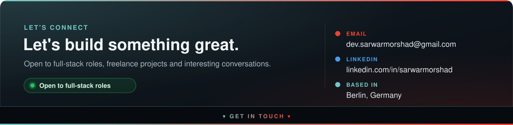

  

## 👋 About me

- 🧑‍💻 **Full-stack developer in Berlin**: React, TypeScript, Node.js and PostgreSQL on the web, React Native and Expo on mobile.
- 🚀 **Building now:** the full digital setup for [Bocado Berlin](https://bocadoberlin.de/), a restaurant using it every day, and [Astha PDF](https://asthapdf.com), 40 private PDF tools that run in the browser.
- 🎓 **M.Sc. Automotive Software Engineering** (TU Chemnitz); my thesis compares deep learning object detection models side by side.
- ✨ **Also into** scroll-driven 3D interfaces (GSAP, Three.js) and AI that runs in the browser (ONNX, YOLO).
- 🤝 **Open to** full-stack roles and freelance projects. Bengali, English (C1) and German (B1).

---

## 🧰 Tech Stack

---

## 💼 Featured Projects

<table>
  <tr>
    <td width="50%" align="center">
      
      
      
    </td>
    <td width="50%" align="center">
      
      
      
    </td>
  </tr>
  <tr>
    <td width="50%" align="center">
      
      
      
    </td>
    <td width="50%" align="center">
      
      
      
    </td>
  </tr>
  <tr>
    <td width="50%" align="center">
      
      
      
    </td>
    <td width="50%" align="center">
      
      
      
    </td>
  </tr>
  <tr>
    <td width="50%" align="center">
      
      
    </td>
    <td width="50%" align="center">
      
      
      
    </td>
  </tr>
</table>

---

## 🧭 Experience & Education

---

## 📊 GitHub Activity

---

## 🤝 Let's Connect

  

